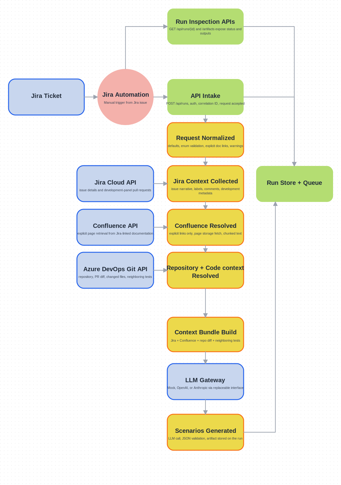

# Jira-Triggered AI Test Generation Agent

Deterministic ASP.NET Core/.NET 10 service for Jira-triggered test-design runs.

The current implementation accepts a Jira Automation-style webhook, normalizes the request, retrieves bounded context from Jira, explicit Confluence links found in the Jira issue, Azure DevOps, and optional Xray coverage, generates candidate scenarios through a replaceable LLM gateway, validates the result, and stores run artifacts for later inspection.



## Current Status

Implemented end-to-end today:

- bearer-token protected `POST /api/runs` intake
- background run queue with persisted run state
- Jira issue retrieval with comments and linked-issue context
- explicit Confluence page retrieval only
- Azure DevOps repository, pull request, diff, and neighboring test retrieval
- Xray neighboring test lookup
- scenario generation through pluggable LLM gateways
- deterministic output validation
- artifact listing and artifact download endpoints
- optional Xray scenario auto-upsert for scenario-design test cases

Not implemented in the current runtime flow:

- Jira writeback stage
- executable test code generation
- repository branch push and draft PR creation from generated code
- Xray test execution upload with test-plan/test-set association
- MCP transport

## Runtime Flow

The background execution path is:

1. `RequestAccepted`: persist the run and enqueue background execution.
2. `RequestNormalized`: apply enum defaults and trim requester data.
3. `JiraContextCollected`: retrieve the Jira issue, selected comments, linked issues, and referenced issue context.
4. `ConfluenceResolved`: fetch only explicit Confluence links found in the fetched Jira issue context.
5. `RepositoryResolved`: resolve Azure DevOps repository and PR or branch context from Jira development metadata.
6. `CodeContextCollected`: collect changed files, bounded unified diffs, and neighboring tests.
7. `XrayContextCollected`: retrieve linked and neighboring Xray tests when enabled.
8. `ContextBundleBuilt`: build the structured prompt bundle and store preview artifacts.
9. `ScenariosGenerated`: call the configured LLM and validate the returned JSON contract.
10. `TestsGenerated`: auto-create or update Xray tests only when Xray auto-upsert is enabled and the run qualifies.
11. `OutputsValidated`: run deterministic validation over generated scenarios.
12. `OutputsWritten`: store markdown/json artifacts and a write summary.

Run observability is stored with each stage and returned by `GET /api/runs/{runId}`:

- `durationMs` is computed when a stage reaches `Succeeded`, `Skipped`, or `Failed`
- `metrics` contains stage-specific counters such as context counts, warning/error counts, prompt character counts, provider request counts, Xray sync counts, and LLM token usage when the provider returns it
- structured logs are emitted when stages start and complete, including stage name, status, duration, and metrics

## API

Authentication:

- `POST /api/runs` requires `Authorization: Bearer <token>` where the token comes from `RunIntakeAuthentication:BearerToken`.
- `GET` endpoints use the same HTTP pipeline and return the stored run state or artifact content.

Current endpoints:

| Route | Description |
| --- | --- |
| `POST /api/runs` | Accept a run request and return `202 Accepted` |
| `GET /api/runs/{runId}` | Return run status, stages, warnings, errors, repository, and PR references |
| `GET /api/runs/{runId}/artifacts` | List stored artifact metadata |
| `GET /api/runs/{runId}/artifacts/{artifactName}` | Return the full content of a stored artifact |
| `GET /health/live` | Liveness probe |
| `GET /health/ready` | Readiness probe |

## Request Contract

The current webhook payload is smaller than earlier planning docs. The API now accepts this shape:

```json
{
  "workflowPass": "ScenarioDesign",
  "issueKey": "QA-1234",
  "requestedBy": "abc-123"
}
```

Notes:

- `issueKey` is the Jira issue key.
- `requestedBy` is the Jira/Atlassian account ID that triggered the run.
- Confluence links are not accepted in the webhook body; they are extracted from the fetched Jira issue description, acceptance criteria, and comments when comment-link parsing is enabled.
- only `https://.../wiki/...` links on allowed hosts are fetched
- test scope starts from the configured default and can be inferred from repository context at runtime
- repository context is derived from Jira development metadata and runtime context

Supported enum values:

| Field | Values |
| --- | --- |
| `workflowPass` | `ScenarioDesign` |

`workflowPass` is the user-facing selector. `ScenarioDesign` is currently the
only supported pass and creates or updates test cases only.

Default normalization values come from `RequestNormalization` in `src/Manso.Api/appsettings.json`.

## Artifacts

The run store keeps artifact metadata and full artifact content. Common artifacts are:

| Artifact | When it appears |
| --- | --- |
| `generation-context-bundle.json` | after context assembly |
| `llm-prompt.json` | after context assembly |
| `generated-scenarios.json` | successful scenario generation |
| `generated-scenarios.md` | successful output writing |
| `validation-report.json` | successful validation |
| `write-result.json` | successful output writing |
| `xray-sync-result.json` | when Xray auto-upsert runs |

Important limitation:

- the current orchestration stores scenario artifacts only; it does not create branches or draft PRs

## Repository Resolution Rules

Repository context is intentionally deterministic:

- repository selection comes from Jira development information
- `ScenarioDesign` accepts open or merged pull requests and ignores rejected or abandoned ones
- if Jira does not uniquely identify one repository, the repository stages are skipped with explicit warnings instead of defaulting silently
- repo-specific test-generation guidance is read only from the fixed Manso paths in the target repo, including `/.manso/repo-conventions.json` when present

## Xray Behavior

The current orchestration path uses two Xray features:

- neighboring Xray test retrieval for prompt context
- optional automatic test case upsert from generated scenarios

The Xray provider client also supports creating Test Executions, updating Test
Run status/comment/evidence, and associating tests/executions with Xray Test
Plans and Test Sets. That execution-upload path is available at the provider
boundary but is not yet invoked by the runtime workflow.

Automatic Xray upsert only runs when all of these are true:

- `XrayRetrieval:EnableScenarioAutoUpsert=true`
- `workflowPass=ScenarioDesign`
- validation outcome is `Pass` or `PassWithWarnings`

## LLM Providers

Supported `Llm:Provider` values:

- `Disabled`
- `Mock`
- `OpenAi`
- `Anthropic`

Provider behavior:

- `Mock` is the safest local default for deterministic development and tests
- `OpenAi` uses Chat Completions for standard models and Responses API for `-pro` and `codex-max` style models
- OpenAI `-pro` models run in background mode and are polled until completion
- `Anthropic` uses the Messages API

## Configuration

Primary configuration sections currently used by the application:

| Section | Purpose |
| --- | --- |
| `ConnectionStrings` | run-store connection string |
| `RunIntakeAuthentication` | bearer token for webhook intake |
| `RunPersistence` | `Postgres` or `InMemory` run storage |
| `RequestNormalization` | internal defaults for scope, coverage, and output |
| `Jira` | Jira API connection settings |
| `JiraRetrieval` | Jira comment retrieval behavior |
| `Confluence` | Confluence API connection settings |
| `DocumentationRetrieval` | Confluence page and chunk limits |
| `Xray` | Xray API connection settings |
| `XrayRetrieval` | Xray lookup and auto-upsert controls |
| `Scm` | Azure DevOps connection settings |
| `RepositoryRetrieval` | changed-file, diff, and neighboring-test limits |
| `GenerationContext` | context bundle size caps |
| `ScenarioGeneration` | minimum and maximum scenario counts |
| `RuntimePrompt` | path to `agent-runtime/` markdown guidance |
| `Validation` | placeholder, path, extension, and assertion rules |
| `Llm` | provider, model, token, timeout, and temperature |

The local baseline config lives in `src/Manso.Api/appsettings.json`.

## Run Locally

Prerequisites:

- .NET 10 SDK
- PostgreSQL if you keep `RunPersistence:Provider=Postgres`
- Jira, Confluence, Azure DevOps, Xray, and LLM credentials only if you want live provider calls

Build and run:

```powershell
dotnet restore src/Manso.sln
dotnet build src/Manso.sln
dotnet test src/Manso.sln
dotnet run --project src/Manso.Api
```

The development profile listens on `http://localhost:5206`.

Example request:

```powershell
$token = "local-dev-token"
$body = @'
{
  "workflowPass": "ScenarioDesign",
  "issueKey": "QA-1234",
  "requestedBy": "abc-123"
}
'@

Invoke-RestMethod `
  -Method Post `
  -Uri http://localhost:5206/api/runs `
  -Headers @{ Authorization = "Bearer $token" } `
  -ContentType "application/json" `
  -Body $body
```

Inspect the run and artifacts:

```powershell
Invoke-RestMethod http://localhost:5206/api/runs/<run-id>
Invoke-RestMethod http://localhost:5206/api/runs/<run-id>/artifacts
Invoke-RestMethod http://localhost:5206/api/runs/<run-id>/artifacts/generated-scenarios.md
```

## Docker

```powershell
docker build -f src/Manso.Api/Dockerfile -t testing-agent-gateway:manso-net10 .
docker run --rm -p 8080:8080 testing-agent-gateway:manso-net10
```

## Repository Layout

```text
testing-agent-gateway/
|- agent-runtime/
|- docs/
|- implementation-plan/
|- infra/
`- src/
   |- Manso.Api/
   |- Manso.Application/
   |- Manso.Domain/
   |- Manso.Infrastructure/
   |- tests/
   |  |- Manso.UnitTests/
   |  `- Manso.IntegrationTests/
   `- Manso.sln
```

Planning and runtime guidance:

- `AGENTS.md` is the repo entry point for agent instructions
- `implementation-plan/00-agent-instructions.md` is the starting point for implementation guidance
- `implementation-plan/` contains the numbered architecture and workflow documents
- `agent-runtime/` contains markdown guidance used during prompt assembly

## Deployment Notes

- the Docker image is built from `src/Manso.Api/Dockerfile`
- Azure pipeline config lives in `.azure/pipeline-app.yaml`
- Key Vault secret declarations for the current deployment live in `infra/terraform/keyvault-SomeTeam-infra.tf`

## Guardrails

- retrieval is bounded and deterministic
- Confluence retrieval is explicit-link only from Jira issue context
- repository write paths are disabled in the current runtime flow
- auto-merge is not allowed
- generated scenarios must pass deterministic validation before output artifacts are finalized
