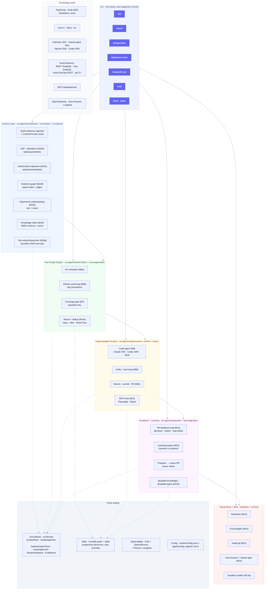
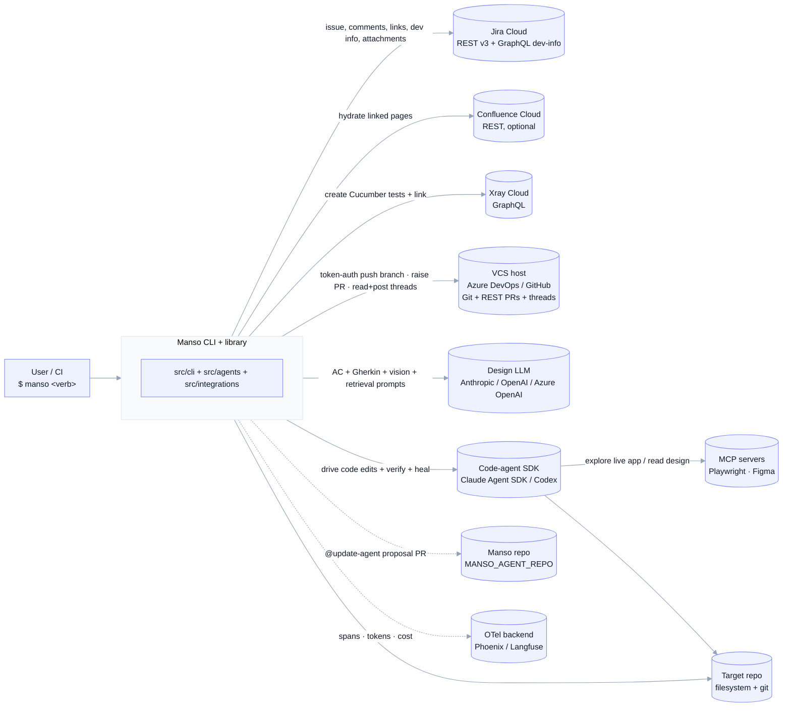
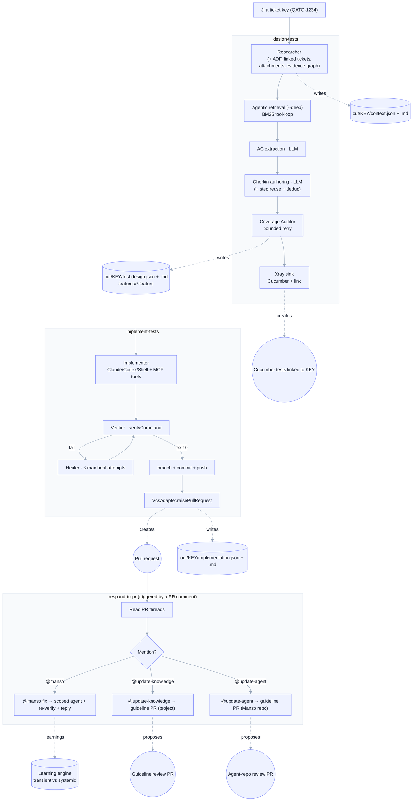
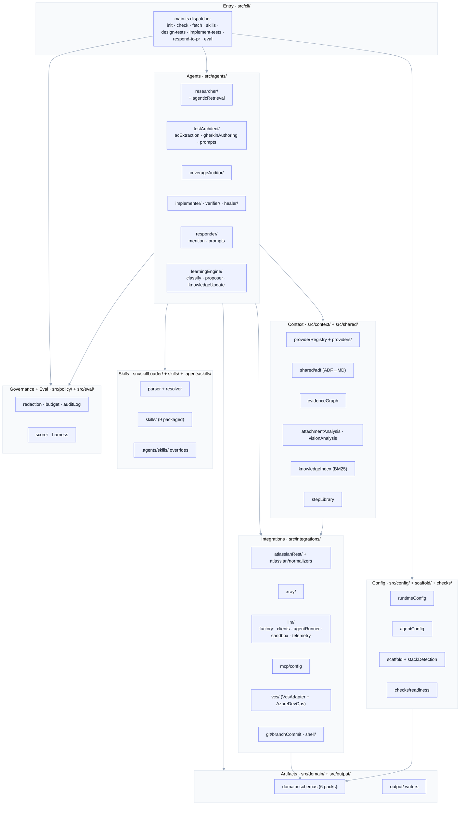

# Manso Architecture

Five views of the same system, outside-in:

1. **Feature & technology map** — everything the system does and what it's built on.
2. **System context** — Manso and the external systems it talks to.
3. **End-to-end pipeline** — `design-tests` → `implement-tests` → `respond-to-pr`.
4. **Layered component view** — the source-tree packages and their dependencies.
5. **Multi-agent topology** — sub-agents and the artifacts between them.

These reflect the code through **M14** plus the delivered roadmap items
(budget-enforcement wiring, audit emission, GitHubAdapter, and token-based push
auth for unattended/pipeline runs). For a feature-by-feature reference see
[FEATURES.md](./FEATURES.md).

> **Theme.** Each diagram opens with a `%%{init: …}%%` directive that sets a
> modern palette and curved edges. To restyle, edit that line — e.g. swap
> `"theme":"base"` for `"dark"`, `"neutral"`, or `"forest"`, or add
> `"look":"handDrawn"` (Mermaid ≥11) for a sketch style. Renders the same in VS
> Code (Markdown Preview Mermaid Support), GitHub, and https://mermaid.live.
>
> **Pre-rendered exports** (SVG + 2× PNG) live in
> [diagrams/](./diagrams/README.md) for slides/wiki use.

---

## 1. Feature & technology map

The whole system at a glance — capability areas (what it does), the modules that
implement them, and the technologies underneath.

---

## 2. System context

Who calls Manso and which external systems it touches.

**Reads from:** Jira, Confluence, target repo, attachments, and (via the code
agent + MCP) the running app and design files.
**Writes to:** Xray (Cucumber tests + links), the target repo (test code), git
(branch + commit), Azure DevOps (push, PR, comment threads), proposal PRs to the
agent repo, `out/` artifacts, and the OTel backend (when `OTEL_ENABLED=true`).

---

## 3. End-to-end pipeline

Gates & guards: Coverage Auditor (`policy.gates.acCoverage`), heal budget
(`--max-heal-attempts`), PR loop-safety (`pr.maxIterationsPerPr` + bot markers),
eval release gate, and sandbox profiles. Learnings are **always proposed via a
separate human-reviewed PR — never applied silently.**

---

## 4. Layered component view

Source tree grouped by responsibility; arrows point toward dependencies.

Notable shape:
- The **Agent Layer** is the only place that combines providers, skills,
  integrations, policy, and artifacts; everything below is a pure capability.
- The **Skills** layer is read-only data with no code dependencies into the rest.
- The **VcsAdapter** is a single seam — **`AzureDevOpsAdapter`** and
  **`GitHubAdapter`** sit behind `resolveVcsAdapter` (remote auto-detection).
  The platform token authenticates both the REST API (PR + comments) and the
  `git push` (via `resolveGitPushAuth` → `git -c http.extraHeader`), so
  unattended/pipeline runs need no local git credentials; absent a token, the
  push falls back to local credentials.
- The **Artifact Layer** (Zod schemas + writers) is the contract every stage
  emits before hand-off.

---

## 5. Multi-agent topology

```mermaid
%%{init: {"theme":"base","themeVariables":{"primaryColor":"#eef2ff","primaryTextColor":"#111827","primaryBorderColor":"#818cf8","lineColor":"#94a3b8","secondaryColor":"#e0f2fe","tertiaryColor":"#f8fafc","clusterBkg":"#f8fafc","clusterBorder":"#e2e8f0","fontFamily":"Segoe UI, Roboto, Helvetica, Arial, sans-serif","fontSize":"14px","edgeLabelBackground":"#ffffff"},"flowchart":{"curve":"basis","htmlLabels":true,"padding":12,"nodeSpacing":50,"rankSpacing":55}}}%%
graph LR
    Start([design-tests]) --> Researcher
    Researcher --> CP[(ContextPack<br/>+ evidence graph)]
    CP --> ACExtract[AC Extraction · LLM]
    ACExtract --> CPe[(ContextPack + ACs)]
    CPe --> GherkinAuthor[Gherkin Authoring · LLM]
    GherkinAuthor --> Draft[(TestDesignPack draft)]
    Draft --> Audit[Coverage Auditor]
    Audit -->|gaps| Retry[Scoped retry] --> Draft
    Audit -->|covered| TDP[(TestDesignPack)]
    TDP --> XraySink[Xray sink] --> XrayTests((Cucumber tests))

    StartImpl([implement-tests]) --> Implementer
    TDP --> Implementer
    Implementer --> IP[(ImplementationPack)]
    IP --> Verifier
    Verifier -->|exit 0| Commit[Commit + token-auth push]
    Verifier -->|fail| Healer --> Verifier
    Commit --> RaisePR[VcsAdapter · Azure / GitHub] --> AzurePR((Pull request))

    StartLoop([respond-to-pr]) --> Responder
    AzurePR --> Responder
    Responder -->|fix| FeedbackFix[Scoped fix + verify + reply]
    Responder -->|update| LearningEngine[Learning engine]
    LearningEngine --> Proposer[Proposer] --> ReviewPR((Guideline review PR))
```

Each box is an independently-testable unit reached through a `runX(input)`
library entry point; every artifact node is a Zod schema in `src/domain/`.

---

## Technology stack

| Area | Technology |
|---|---|
| Language / runtime | TypeScript, Node ≥20, ESM (NodeNext), `strict` + `noUncheckedIndexedAccess` + `exactOptionalPropertyTypes` |
| Validation | Zod v4 (every artifact + config) |
| Tests / tooling | Vitest, tsx, tsc |
| Design LLM | Anthropic Messages, OpenAI Responses, OpenAI/Azure OpenAI Chat Completions (auto-detected); multimodal (vision) |
| Code agent | Claude Agent SDK, OpenAI Codex SDK, Shell runner |
| Tools | MCP (stdio / http / sse) — Playwright, Figma |
| Issue tracking | Jira Cloud REST v3 + GraphQL dev-info; Confluence REST |
| Test management | Xray Cloud GraphQL (Cucumber test type) |
| VCS | Azure DevOps REST + GitHub REST (PRs + comment threads), git CLI |
| Observability | OpenTelemetry + Arize OpenInference → Phoenix / Langfuse |
| Retrieval | BM25 (lexical, no embedding API) |

---

## Roadmap (next milestones)

Detailed specs: **[ROADMAP.md](./ROADMAP.md)**.

| ID | Milestone | What changes |
|---|---|---|
| 🔥 **M20** | **Environment-aware, explore-before-implement** | **Spin up the app (Docker) once around the run; explore the live UI (Playwright MCP → real DOM locators) or API (OpenAPI/Swagger → endpoints + schemas) to ground the tests; implement, verify against the running env, tear down. Adds stack `kind`/`setupCommand`/`teardownCommand`/`appUrl`/`openApiUrl`. Highest-priority quality milestone.** |
| M19 | Xray Manual-test upload | Upload plain-English scenarios to Xray as Manual tests (Gherkin already uploads as Cucumber). |
| — | Devcontainer/Dagger sandbox | Run the code agent in an isolated container mapped to sandbox profiles. |
| — | More stacks | Cypress + others — one binding skill + one verify config + one eval repo each. |

**Delivered since the MVP:** M17 GitHubAdapter (PR + comment threads for
github.com/Enterprise); **token-based push auth** (`resolveGitPushAuth` →
`git -c http.extraHeader`) so the VCS token authenticates the `git push` as well
as the REST API, with a fallback to local git credentials; **M15** budget
enforcement (daily cost ledger + halt + `budget.breached`); **M16** audit
emission at every mutating action + the `manso audit` reader; **M21** the
`humanReviewBeforeUpload` gate (auto-confirm Xray upload for unattended runs) —
together these make Manso safe to run unattended in a pipeline.

---

## Cross-cutting concerns

| Concern | Where |
|---|---|
| Configuration | `src/config/` — env (`runtimeConfig`) + per-repo JSON (`agentConfig`) |
| Skills (progressive disclosure) | `src/skillLoader/` + `skills/` + `.agents/skills/` (repo overrides win) |
| Artifact contracts | `src/domain/*/schema.ts` — Zod-validated, `schemaVersion` + `provenance` + `warnings` |
| Provenance + warnings | Every external call records `{method, toolName, calledAt, success}` into the pack |
| Secrets / PII | `.env` only (gitignored); MCP `${ENV_VAR}` expansion; redaction before logs/telemetry/audit |
| Sandbox | `src/integrations/llm/sandbox.ts` — `MANSO_SANDBOX` profile |
| Telemetry | `src/integrations/llm/telemetry/` — OTel; no-op when `OTEL_ENABLED=false`; flushed on exit |
| Validation tests | `test/*.test.ts` — 279 tests, fixture/mock-based, no network |
