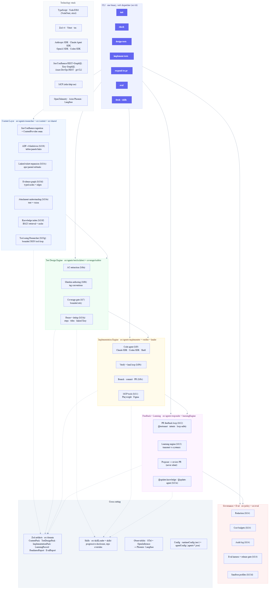
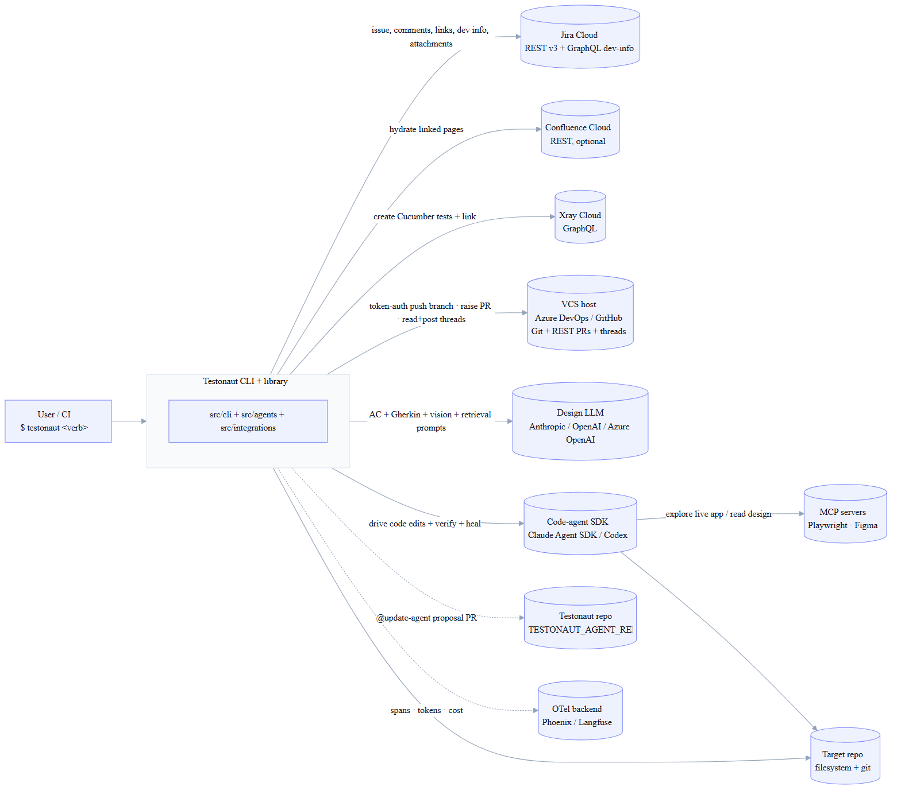
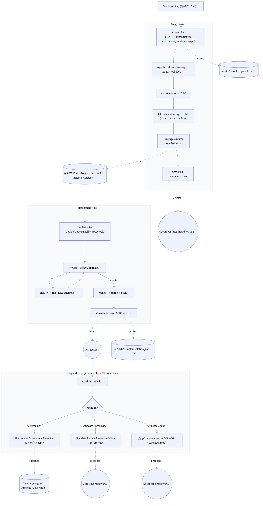
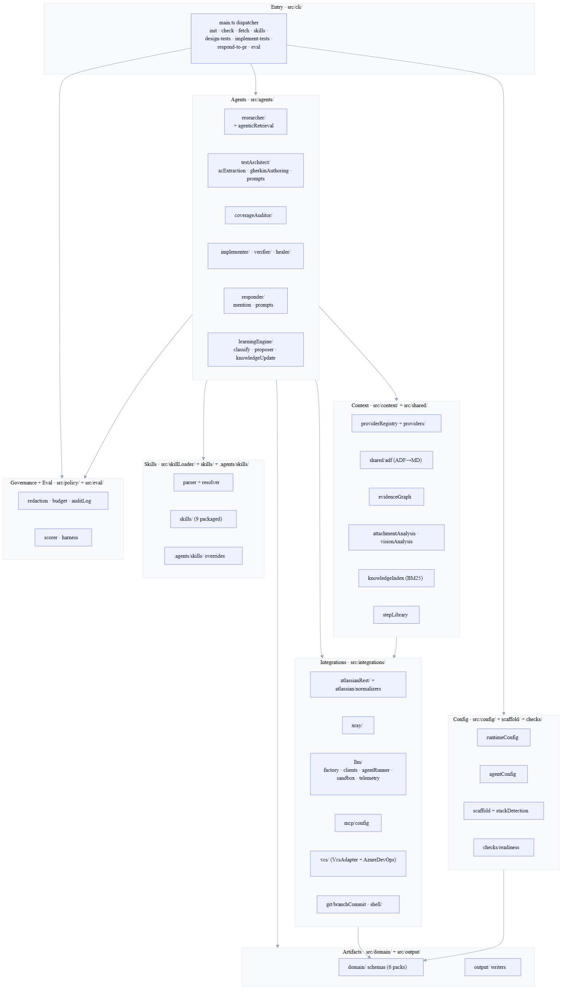
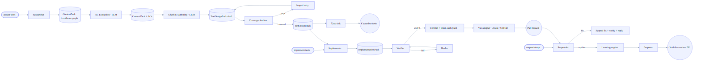

# Architecture diagrams (rendered)

Pre-rendered exports of the diagrams in [../architecture.md](../architecture.md),
using the modern theme. Each diagram is available as **SVG** (vector, crisp at
any zoom — best for docs/wiki) and **PNG** (2× raster — best for slides/chat).

Regenerate after editing `architecture.md`:

```bash
npx -p @mermaid-js/mermaid-cli@11 mmdc -i docs/architecture.md \
  -o docs/diagrams/out.md -b white -e svg   # then rename out-N.svg
```

---

## 1. Feature & technology map
The whole system on one canvas — capability lanes, modules, and the tech stack.



[SVG](./1-feature-technology-map.svg)

## 2. System context
Manso and the external systems it reads from / writes to.



[SVG](./2-system-context.svg)

## 3. End-to-end pipeline
`design-tests` → `implement-tests` → `respond-to-pr`, with gates and artifacts.



[SVG](./3-end-to-end-pipeline.svg)

## 4. Layered component view
The source-tree packages grouped by responsibility, with dependency direction.



[SVG](./4-component-view.svg)

## 5. Multi-agent topology
The sub-agents and the Zod artifacts that flow between them.



[SVG](./5-multi-agent-topology.svg)
