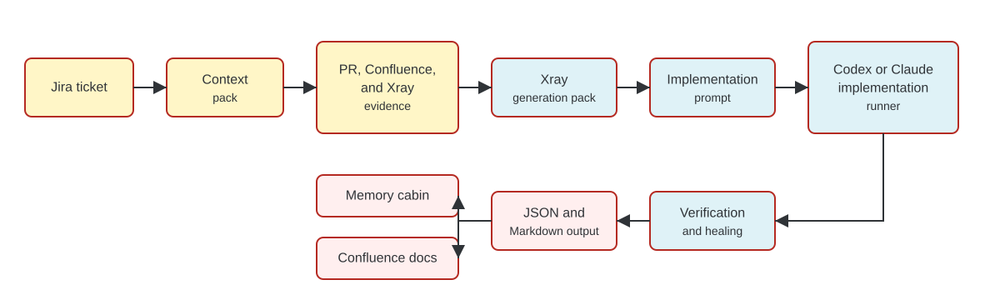
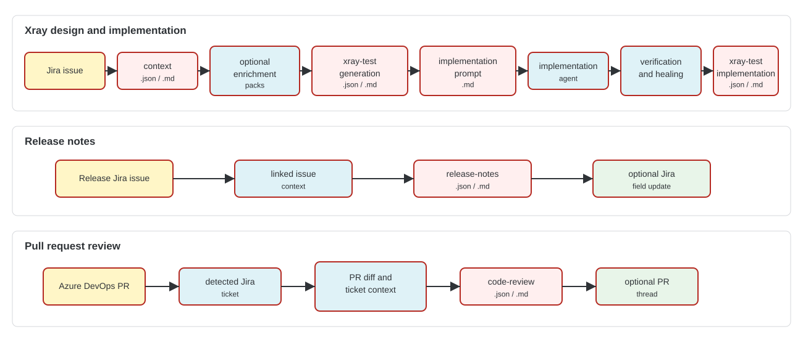

# Manso Workflow Map



Source: [manso-agent-workflow.mmd](media/manso-agent-workflow.mmd)

## Common Workflow Shape

Most workflows follow the same pattern:

1. Parse CLI arguments and load runtime configuration.
2. Extract source evidence from Jira, Confluence, Azure DevOps, Xray, git, or local files.
3. Normalize and validate data through domain schemas.
4. Ask the configured LLM provider to summarize, plan, review, or implement when the workflow requires model reasoning.
5. Write JSON and Markdown artifacts under `out/<scope>/`.
6. Mirror artifacts to the memory cabin when configured.
7. Perform external writes only when the selected command and flags allow it.

## Workflow Details

| Workflow | Reads | Model-backed stages | Writes |
| --- | --- | --- | --- |
| `generate-xray-tests` | Jira issue, comments, links, Confluence pages, existing Xray tests, PR metadata and diffs | Xray coverage review, PR summary, Confluence impact summary, Xray test planning | Local artifacts, optional Xray tests, Test Set, and Jira links |
| `implement-xray-tests` | Xray generation pack, target repository, repository guidance files | Implementation prompt execution, optional verification healing | Local artifacts, implementation branch, commits, push, Azure DevOps PR |
| `generate-release-notes` | Release Jira ticket, linked Jira tickets, Confluence pages, branches, PR metadata | Release-note summarization | Local artifacts and optional Jira field update |
| `review-pull-request` | Azure DevOps PR diff, detected or supplied Jira ticket, Confluence pages, repository metadata | Code and business review | Local artifacts and optional Azure DevOps PR thread |

## Implementation Modes

`implement-xray-tests` has three implementation inputs:

| Mode | How to run | Scope source |
| --- | --- | --- |
| Test design enabled | `--issue ABC-123 --TestDesignEnabled true` | Runs the design workflow first, then implements the generated Xray plan. |
| Linked Xray implementation | `--issue ABC-123 --TestDesignEnabled false` | Extracts existing linked Xray tests and implements them without creating new test designs. |
| Existing pack | `--xray-test-generation ./out/ABC-123/xray-test-generation.json` | Implements a previously generated pack. |

Use `--prompt-only` to stop after prompt generation. Use `--dry-run` for stronger local-only behavior; it implies prompt-only for implementation and keeps generated Xray design local when test design is enabled.

## Data Flow



Source: [manso-agent-data-flows.mmd](media/manso-agent-data-flows.mmd)

```text
Jira issue
  -> context.json/md
  -> optional enrichment packs
  -> xray-test-generation.json/md
  -> xray-test-implementation-prompt.md
  -> implementation agent
  -> verification and healing
  -> xray-test-implementation.json/md
```

For release notes:

```text
Release Jira issue
  -> linked issue context
  -> release-notes.json/md
  -> optional Jira field update
```

For pull request review:

```text
Azure DevOps PR
  -> detected Jira ticket
  -> PR diff and ticket context
  -> code-review.json/md
  -> optional PR thread
```
